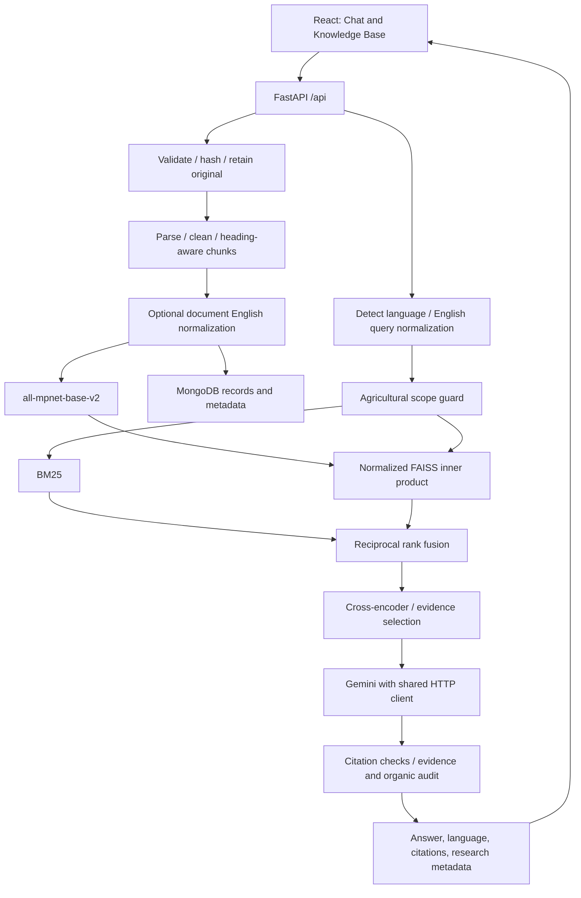

# Architecture



## Responsibilities

| Directory | Responsibility |
| --- | --- |
| backend/src/ingestion | Validation, parsers, cleanup, durable jobs |
| backend/src/chunking | Bounded chunks, headings, sentence overlap |
| backend/src/embeddings | Lazy CPU MPNet loading and normalized vectors |
| backend/src/database | MongoDB connection, indexes, records |
| backend/src/vectordb | FAISS persistence, checksum, manifest, mappings |
| backend/src/retrieval | BM25, dense search, RRF, cross-encoder |
| backend/src/translation | Script/style detection and English normalization |
| backend/src/llm | Google GenAI SDK; startup connection check and shared client |
| backend/src/guardrails | Scope, citation validation, optional semantic audit |
| backend/src/api | Pydantic input/output schemas and all API endpoints |
| frontend/src/services | Centralized API URLs, requests, errors |

## Data and consistency

MongoDB stores source metadata and chunk text, not embedding vectors.
Every chunk has a UUID and parent document ID. FAISS uses normalized float32
vectors with IndexFlatIP; its manifest maps positions to chunk UUIDs and source
text hashes, records the embedding model and dimension, and hashes the index.
The complete new snapshot is written before an atomic manifest replacement.
Old index generations are removed only after the commit.

A unique SHA-256 file_hash index prevents duplicate documents. Operations are
serialized with an RLock. Ingestion replaces the document's chunk records,
commits the index containing those chunks, and then marks the document indexed.
Search uses only indexed documents and reconciles the manifest with the current
chunk set. A crash before indexed status cannot make the partial document
searchable; startup marks interrupted jobs failed. Deletion marks a document
deleting before removing vectors and files, and startup resumes interrupted
deletion. There is no distributed transaction between MongoDB and FAISS; the
state machine and reconciliation are the recovery mechanism.

## API

| Method | Path | Behavior |
| --- | --- | --- |
| GET | /api/health | Database/index state, provider configuration; 503 when degraded |
| POST | /api/documents/upload | Multipart file and optional metadata; 202 + document/job IDs |
| GET | /api/documents | Documents and aggregate counts |
| GET | /api/documents/{id} | Public metadata, excluding filesystem paths |
| GET | /api/documents/{id}/file | Original as an attachment |
| DELETE | /api/documents/{id} | Remove records, chunks, original, processed text, vectors |
| POST | /api/documents/{id}/reindex | 202 + durable job ID |
| GET | /api/jobs/{id} | Actual phase, progress, timestamps, failure detail |
| GET | /api/sources/{id} | Chunk passage and source metadata, or document metadata |
| POST | /api/chat | Question, optional history and exact metadata filters |

```json
{
  "question": "How do I grow organic ginger?",
  "history": [],
  "filters": {"crop": "ginger"}
}
```

Chat replies include answer, detected_language, citations, evidence_status
(supported / insufficient / out_of_scope), and research metadata. Citation IDs
are assigned to the selected passages and checked before publication. The source
drawer retrieves the exact chunk by UUID rather than relying on model-written URLs.

## Operational boundaries

One backend process and one worker; localhost bindings; only the two local Vite
origins in CORS; no authentication. Provider keys remain backend-only. Uploads do
not prove source authenticity. The prototype does not perform OCR, execute macros,
or guarantee the scientific correctness of a source or the model's interpretation.
Model or parser failures remain failures and can be retried through reindexing.
The UI never supplies dummy answers or synthetic upload success.
